<div align="center">


<br>


**Controle financeiro pessoal que lê teu extrato e teu holerite, separa os gastos sozinho e te diz quando a reserva bate.**

[Rodar em 1 minuto](#-rodar-em-1-minuto) · [O que ele faz](#-o-que-ele-faz) · [Criar conta](#-criar-conta) · [Configuração](#%EF%B8%8F-configuração) · [Arquitetura](#-arquitetura)

<br>

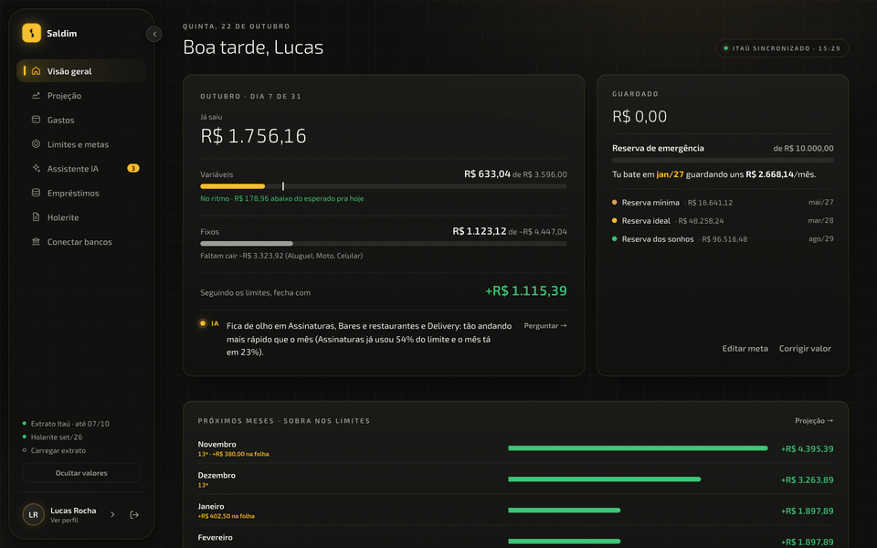

<sub>Tudo o que aparece nas imagens é <b>fictício</b>: é o usuário demo que o seed cria.</sub>

</div>

---

## ✨ O que ele faz

| | |
|---|---|
| 📥 **Importa do jeito que tu tiver** | Extrato em PDF do Itaú, OFX, CSV ou JSON, além do holerite em PDF. Também conecta o banco por **Open Finance** (Pluggy). Lançamento repetido não entra duas vezes. |
| 🏷️ **Categoriza sozinho** | 21 categorias (mercado, delivery, transporte, assinaturas, Pix pra pessoas…) definidas por regras. O que é só teu (nome de quem recebe o aluguel, por exemplo) vai no `.env`, fora do código. |
| 🎯 **Limites que avisam antes** | Cada categoria tem um limite e uma barra de ritmo: tu vê se tá gastando mais rápido que o mês anda. |
| 📈 **Projeção de 15 meses** | Junta salário, 13º, empréstimos que terminam e limites pra mostrar quando a reserva chega lá, com e sem o plano. |
| 🧾 **Holerite destrinchado** | Do bruto ao líquido: INSS, IRRF, consignados. Mostra quanto o líquido sobe quando cada parcela termina. |
| 💳 **Empréstimos sob controle** | Consignados na folha e débitos na conta, com quanto falta e quando acaba. |
| 🤖 **Assistente IA** | Pergunta "posso trocar de celular?" e ele responde com os teus números. Usa o Claude se tiver chave, ou responde por regras se não tiver. |
| 🔐 **Entrar com o rosto** | Depois do primeiro login, o aparelho lembrado entra sem senha. |
| 📱 **Um app só** | Sidebar no desktop, tab bar e tela "Mais" no celular. |

<details>
<summary><b>📸 Ver todas as telas</b></summary>
<br>

| Visão geral | Gastos |
|---|---|
| 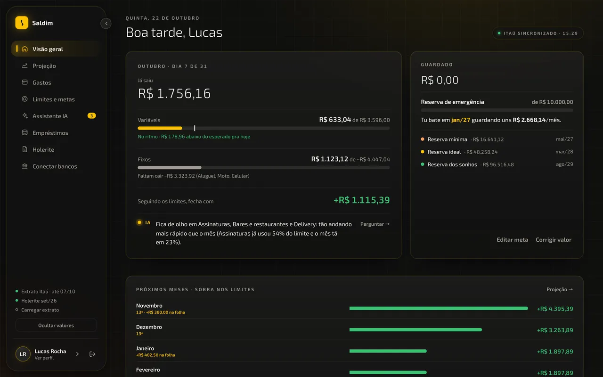 | 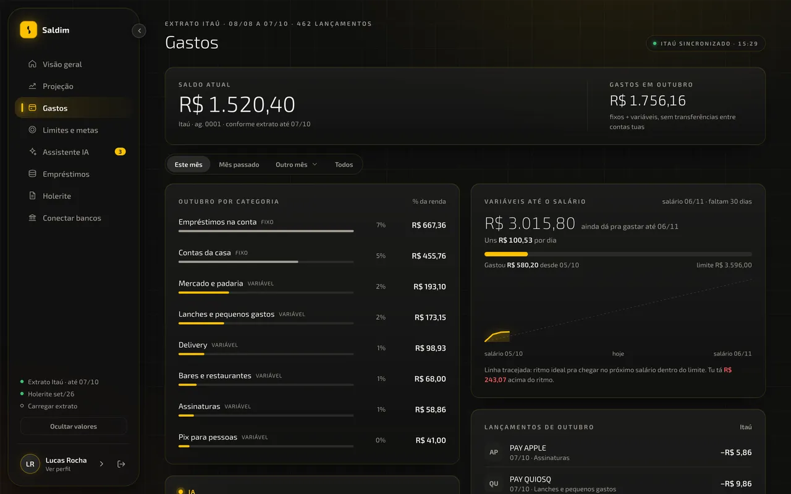 |
| **Projeção** | **Limites e metas** |
| 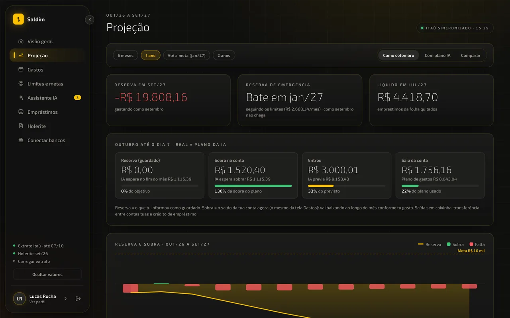 | 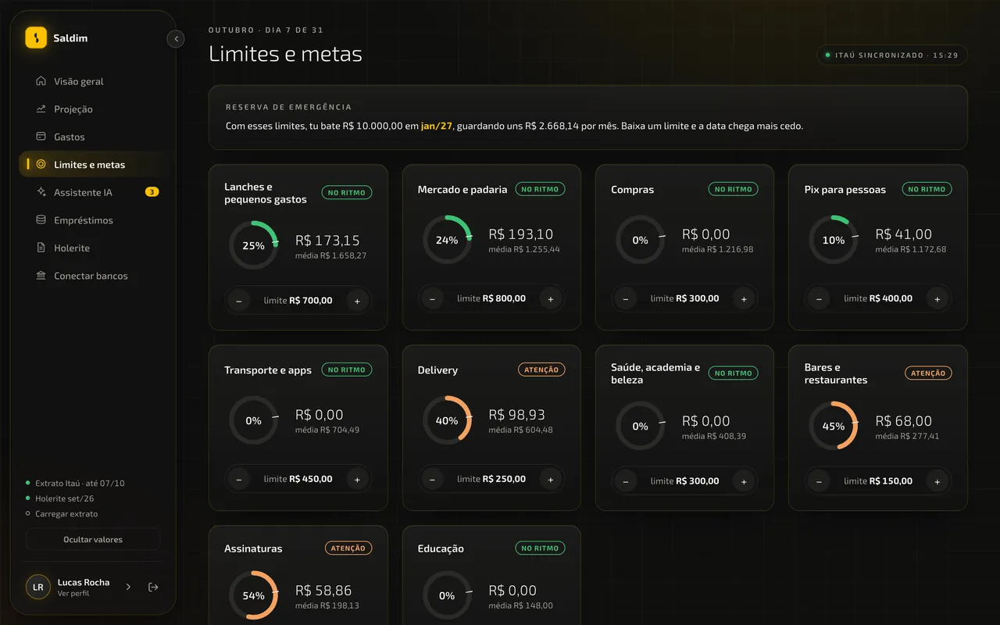 |
| **Assistente IA** | **Holerite** |
| 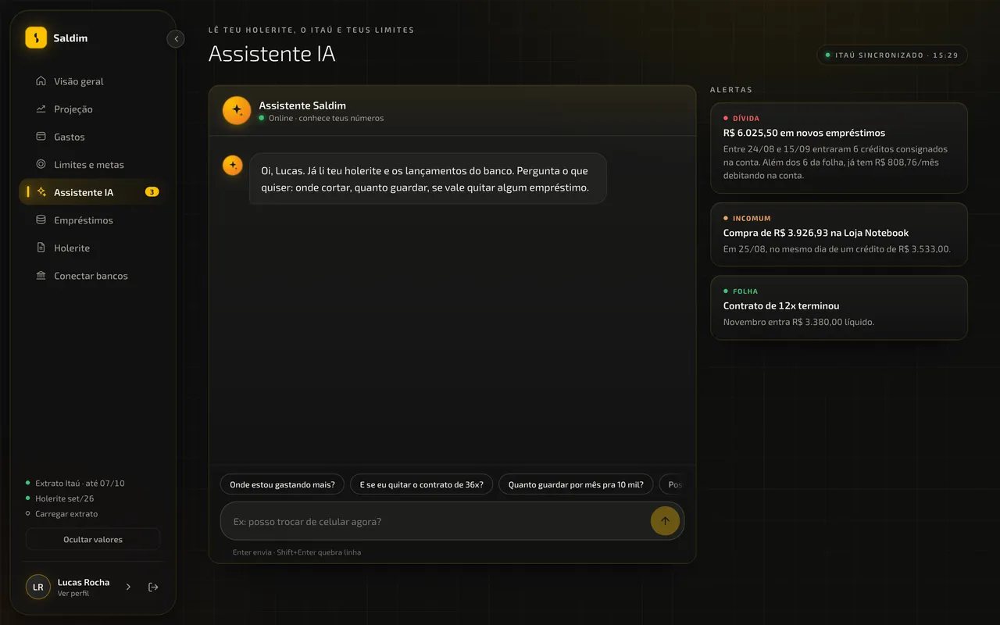 | 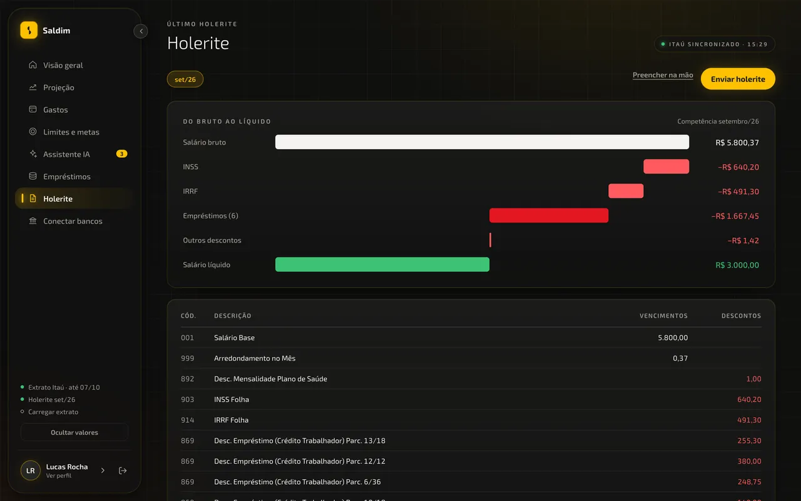 |
| **Empréstimos** | **Conectar bancos** |
| 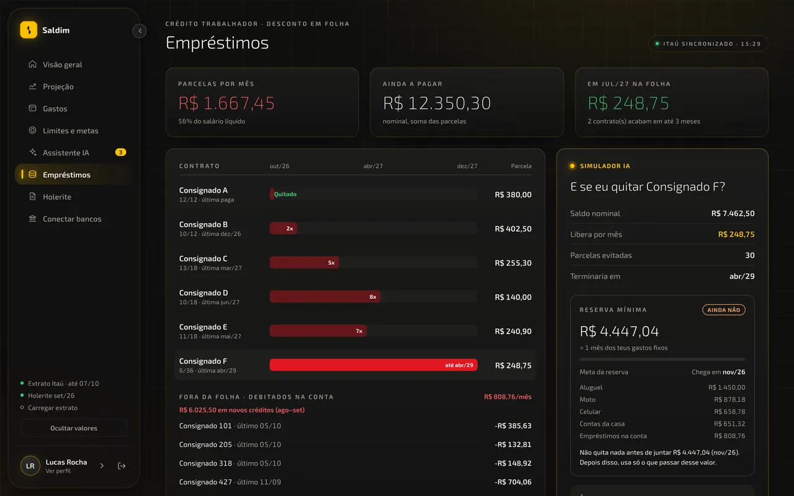 | 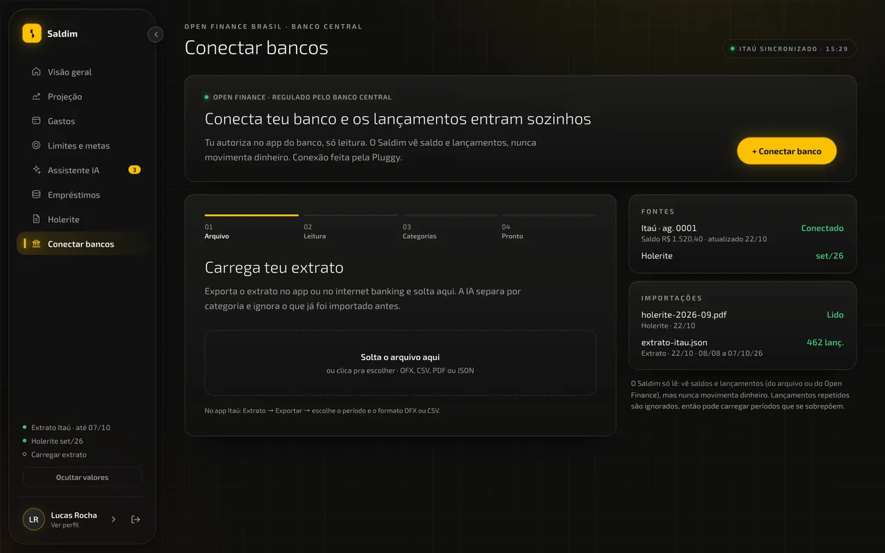 |

</details>

### 📱 No celular

<table>
<tr>
<td width="300">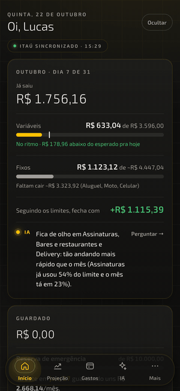</td>
<td>

Abaixo de 768px o app vira mobile: **tab bar** embaixo (Início, Projeção, Gastos, IA) e uma tela **Mais** com o resto (limites, empréstimos, holerite, bancos e perfil).

É o mesmo app e a mesma URL, sem precisar instalar nada.

<br>

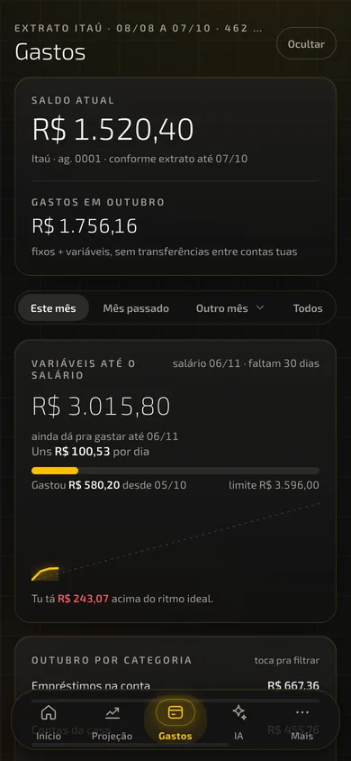 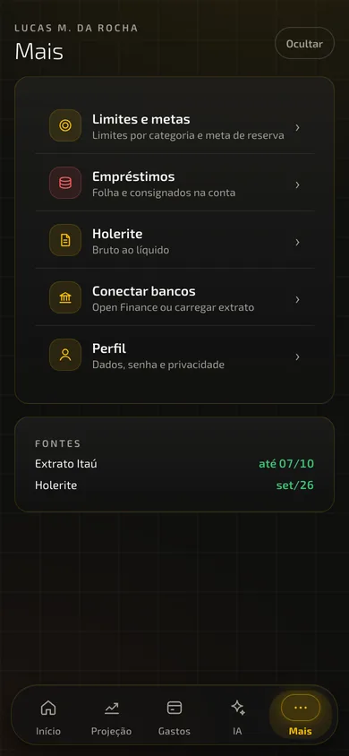

</td>
</tr>
</table>

---

## 🚀 Rodar em 1 minuto

Só precisa do **Docker**.

```bash
git clone https://github.com/GabriellCastro/saldim.git
cd saldim
cp .env.example .env
docker compose up --build
```

| | |
|---|---|
| 🌐 Web | http://localhost:3001 |
| ⚙️ API | http://localhost:3333 |
| 👤 Login demo | `demo@saldim.dev` / `Saldim@2026` |

O compose sobe o Postgres, aplica as migrações, roda o seed e abre a web. O usuário demo vem com 2 meses de extrato, um holerite, 6 consignados, limites e uma meta, tudo **inventado**, só pra ter números na tela.

### 🛠️ Desenvolvimento (com hot reload)

Precisa de **Node 20+**, **pnpm** e Docker (só pro banco).

```bash
pnpm install
cp .env.example .env
pnpm db:up          # sobe só o Postgres
pnpm db:migrate     # aplica as migrações
pnpm db:seed        # usuário demo + dados fictícios
pnpm dev            # api :3333 + web :3000 em watch
```

```bash
pnpm test           # testes da api (jest)
```

> [!TIP]
> Em dev, mantenha `NEXT_PUBLIC_API_URL=http://localhost:3333` e `WEB_ORIGIN=http://localhost:3000,http://localhost:3001` no `.env`.

---

## 👤 Criar conta

<table>
<tr>
<td width="55%">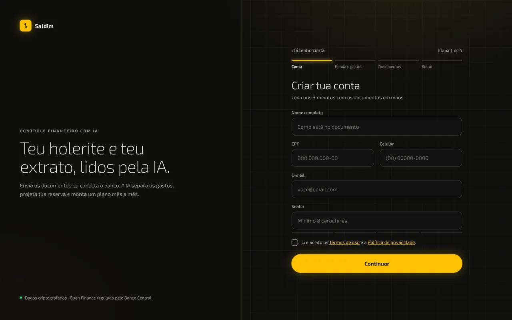</td>
<td>

O cadastro fica em **`/registro`**. Na tela de login tem o link **"Criar conta"**.

1. **Conta**: nome, CPF, celular, e-mail e senha
2. **Renda e gastos**: tu escolhe como a IA vai ler teu dinheiro
3. **Documentos ou banco**: manda extrato e holerite, **ou** conecta pelo Open Finance
4. **Rosto** *(opcional)*: pra entrar sem senha neste aparelho

</td>
</tr>
</table>

### Abrir ou fechar o cadastro

Quem controla é a variável **`REGISTRATION_OPEN`**:

| Valor | O que acontece |
|---|---|
| `true` *(padrão)* | qualquer pessoa cria conta |
| `false` | `/registro` volta pro login, o link "Criar conta" some e `POST /auth/register` responde **403** |

API e web leem a mesma variável na hora (sem rebuild). Pra deixar uma instância só pra ti: cria tua conta, depois põe `REGISTRATION_OPEN=false` na API e na web e reinicia.

---

## ⚙️ Configuração

Tudo vem comentado em [`.env.example`](.env.example).

| Variável | Obrigatória | Pra quê |
|---|:---:|---|
| `POSTGRES_*`, `DATABASE_URL` | ✅ | banco |
| `JWT_SECRET` | ✅ | assina o cookie de sessão. **Troque fora do dev** (`openssl rand -hex 32`) |
| `WEB_ORIGIN` | ✅ | origens liberadas no CORS (separadas por vírgula) |
| `NEXT_PUBLIC_API_URL` | ✅ | endereço da API visto pelo navegador (entra no build da web) |
| `REGISTRATION_OPEN` | | abre/fecha o cadastro (padrão: aberto) |
| `SEED_ON_START` | | no docker, roda o seed ao subir a API. Use `false` fora do dev: o seed redefine a senha do demo |
| `CATEGORY_RULES` | | regras pessoais do categorizador ([ver abaixo](#-regras-pessoais-do-categorizador)) |
| `API_BASE_PATH` | | prefixo quando a API fica atrás de um proxy em `/api` |
| `ANTHROPIC_API_KEY` | | liga o assistente com Claude. Sem ela, o assistente responde por regras com os teus números |
| `ANTHROPIC_MODEL`, `USD_BRL` | | modelo usado e cotação pra mostrar o gasto da IA em reais |
| `PLUGGY_CLIENT_ID`, `PLUGGY_CLIENT_SECRET` | | Open Finance ([dashboard.pluggy.ai](https://dashboard.pluggy.ai) → Applications) |
| `PLUGGY_WEBHOOK_URL`, `PLUGGY_WEBHOOK_SECRET` | | webhook da Pluggy (URL pública da API + um segredo qualquer) |

### 🏷️ Regras pessoais do categorizador

As regras genéricas (iFood, Uber, mercado, farmácia…) ficam em [`categorizer.ts`](apps/api/src/categorizer/categorizer.ts). O que é **só teu** fica no `.env`, nunca no código:

```bash
CATEGORY_RULES="PIX TRANSF FULANO=propria;PIX TRANSF CICLANA=moradia:out;FINANCEIRA X=moto"
```

- Formato: `REGEX=categoria[:in|out]`, com regras separadas por `;`
- A comparação é feita com a descrição **em maiúsculas e sem acento**
- Essas regras valem **antes** das genéricas
- Os ids de categoria estão em [`categories.ts`](apps/api/src/categories/categories.ts)

<details>
<summary><b>Exemplos de uso</b></summary>

| Situação | Regra |
|---|---|
| Pix pra tua outra conta não é gasto | `PIX TRANSF TEUNOME=propria` |
| Pix mensal pro dono do apê é aluguel | `PIX TRANSF FULANO=moradia:out` |
| Boleto da financeira é a parcela da moto | `BANCO X MOTOR=moto` |
| Loja onde tu parcelou o celular | `LOJA Y=celular` |

</details>

---

## 🧭 Arquitetura

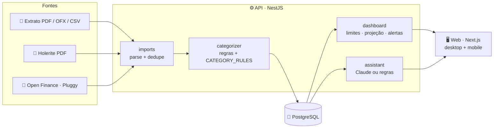

```
apps/api     NestJS 11 + Prisma 6     um módulo por feature em src/<feature>/
apps/web     Next.js 15 App Router    telas em src/features/, CSS Modules + tokens
docs/api.md  contrato da API (fonte da verdade entre api e web)
design/      telas originais (Claude Design) usadas como referência visual
```

<details>
<summary><b>Como as peças conversam</b></summary>
<br>

- **Autenticação**: JWT em cookie httpOnly. Toda rota é autenticada por padrão; as públicas usam `@Public()`.
- **Isolamento**: toda query filtra por `userId`.
- **Dinheiro**: `Decimal` no banco, convertido num lugar só (`src/common/money.ts`).
- **Web**: SWR + `fetcher` de `src/lib/api.ts`. Os gráficos são SVG próprio, sem lib de chart.
- **Contrato**: qualquer mudança de rota passa por [`docs/api.md`](docs/api.md).

Convenções completas em [CLAUDE.md](CLAUDE.md).

</details>

---

## 🔒 Privacidade

- Extratos, holerites e `.env` **nunca** entram no git.
- Os dados de exemplo (`apps/api/prisma/data/extrato-itau.json`, seed e design) são **inventados**.
- Regras com nomes de pessoas vão em `CATEGORY_RULES`, no `.env`.
- O assistente só fala com a IA se tu configurar `ANTHROPIC_API_KEY`. Nesse caso, manda pra API da Anthropic teu primeiro nome, um resumo dos números (renda, fixos, limites, empréstimos), os lançamentos dos últimos 2 meses e a conversa. Sem a chave, nada vai pra IA.

<div align="center">
<br>
<sub>Feito em pt-BR, com cara de app de banco e conversa de amigo. 💛</sub>
</div>
